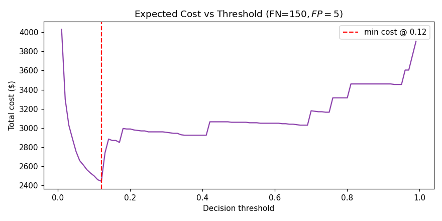

# 💳 Financial Fraud Detection Analytics

### 🚀 [**Try the live dashboard →**](https://financial-fraud-detection-9arzobmjkhfrofqg4dqma4.streamlit.app/)

[](https://financial-fraud-detection-9arzobmjkhfrofqg4dqma4.streamlit.app/)

End-to-end machine-learning pipeline that detects fraudulent credit-card transactions
in a **severely imbalanced** dataset (0.17% fraud) — and turns the model into an
actual **cost-based business decision** rather than chasing accuracy.

**TL;DR:** XGBoost (PR-AUC **0.82**) → a cost-optimal **0.12** decision threshold that
catches **84% of fraud** and cuts estimated fraud cost **~20%** vs the naive default,
delivered through an interactive Streamlit dashboard.

---

## 🎯 Why this project

On a dataset that is 99.83% legitimate, a model that blindly predicts *"never fraud"*
scores **99.8% accuracy and catches zero criminals**. This project is built around that
trap: every decision is driven by **recall, precision, PR-AUC, and dollar cost** — not
accuracy. It also includes an honest **negative result** (engineered features that were
tested and removed) and a frank limitations section, because over-claiming is the fastest
way to lose a reviewer's trust.

## 📊 Key results

| | |
|---|---|
| Transactions analysed (post-dedup) | **283,726** |
| Fraud rate | **0.17%** (473 cases) |
| Best model | **XGBoost** — PR-AUC 0.82, ROC-AUC 0.97 |
| Recommended threshold | **0.12** (cost-optimal) |
| Fraud caught @ 0.12 | **84%** recall, 67% precision |
| Est. cost reduction vs default 0.50 | **~20%** ($3,060 → $2,445) |

### Model comparison (held-out test set, ranked by PR-AUC)
| Model | Recall | Precision | PR-AUC | ROC-AUC |
|-------|-------:|----------:|-------:|--------:|
| **XGBoost** 🏆 | 0.79 | 0.86 | **0.82** | 0.97 |
| Random Forest | 0.72 | 0.97 | 0.81 | 0.94 |
| Logistic Regression *(baseline)* | 0.87 | 0.06 | 0.67 | 0.97 |
| SVM *(subsample)* | 0.48 | 0.41 | 0.47 | 0.94 |

> **The PR-AUC vs ROC-AUC lesson:** Logistic Regression posts a gorgeous ROC-AUC (0.97)
> while its precision is a catastrophic **5.6%** — only ~1 flag in 18 is real fraud.
> ROC-AUC flatters models under heavy imbalance; PR-AUC tells the truth.

## 💡 Headline insights
- **Fraud spikes at night:** fraud rate peaks at **2–4 AM (~8× baseline)** despite that
  being the lowest-traffic window — a cheap, actionable risk signal.
- **Fraud hides in small amounts:** median fraud is **$9.25** vs $22 for legit
  transactions (classic *card-testing*) — the mean ($122) is misleading.
- **The threshold is a business lever:** chasing maximum recall triggers 3,558 false
  alarms and *sextuples* cost; the cost-optimal 0.12 threshold balances both.



## 🖥️ Dashboard

`streamlit run dashboard/app.py` — four tabs:
**Overview** (KPI cards) · **Explore** (EDA charts) · **🎚️ Threshold simulator**
(drag the threshold, watch recall/precision/cost update live) · **Score a transaction**
(sample a real transaction → risk score + band).

## 🗂️ Dataset

**ULB Credit Card Fraud** — 284,807 European card transactions, features PCA-anonymised
(`V1–V28`) plus `Time`, `Amount`, `Class`. *(PaySim mobile-money is the planned next
iteration for interpretable feature engineering.)*

**Download** (not in git — too large): get `creditcard.csv` from
[Kaggle](https://www.kaggle.com/datasets/mlg-ulb/creditcardfraud) and place it at
`data/raw/creditcard.csv`.

## 🔧 Tech stack
Python · Pandas · NumPy · Matplotlib · Seaborn · scikit-learn · imbalanced-learn ·
XGBoost · Streamlit · Jupyter

## 🚀 Quickstart
```bash
cd financial-fraud-detection
python -m venv .venv && source .venv/bin/activate
pip install -r requirements.txt
# place creditcard.csv in data/raw/  (see Dataset above)

python src/preprocessing.py     # clean + leak-safe train/test splits
python src/models.py            # train & compare 4 models, save the best
python src/evaluate.py          # PR/ROC curves + cost-based threshold tuning
streamlit run dashboard/app.py  # launch the interactive dashboard
```
> **macOS + XGBoost:** needs the OpenMP runtime. If you see
> `libxgboost.dylib could not be loaded`, run `brew install libomp`
> (or `conda install -c conda-forge llvm-openmp`).

## 📁 Project structure
```
financial-fraud-detection/
├── data/raw/              creditcard.csv (gitignored)
├── data/processed/        leak-safe splits + fitted scaler
├── src/                   modular pipeline
│   ├── data_loader.py     load + first-look summary
│   ├── preprocessing.py   dedup, RobustScaler, stratified split (leak-safe)
│   ├── eda.py             all EDA figures
│   ├── features.py        feature engineering + audit
│   ├── imbalance.py       class weights / SMOTE (train only)
│   ├── models.py          train & compare LogReg, RF, XGBoost, SVM
│   └── evaluate.py        curves + cost-based threshold tuning
├── notebooks/             01_eda, 02_eda_deep, 03_modeling (executed)
├── reports/               figures, markdown reports, LaTeX PDF
├── dashboard/app.py       Streamlit app
└── models/                best_xgboost.joblib
```

## 🧪 Methodology highlight — no data leakage
The cardinal rule, enforced in code: **split first, then fit the scaler on train only,
then resample train only.** Anything that learns from data (scaler statistics, SMOTE)
never sees the test set, so reported metrics reflect genuinely unseen transactions.

## 📄 Reports
- `reports/business_insights.md` — 1-page exec summary (non-technical stakeholders)
- `reports/analysis_report.md` — full technical + business report (GitHub-rendered)
- `reports/analysis_report.tex` + `.pdf` — polished 8-page LaTeX report (A4)

Recompile the PDF ([Overleaf](https://overleaf.com), or `cd reports && tectonic analysis_report.tex`).

## ✅ Roadmap (complete)
<details><summary>All 10 phases</summary>

- [x] Phase 0 — Project setup
- [x] Phase 1 — Load & explore
- [x] Phase 2 — Clean & preprocess (dedup, RobustScaler, leak-proof split)
- [x] Phase 3 — EDA: time patterns, feature separation
- [x] Phase 4 — Feature engineering (+ honest negative result)
- [x] Phase 5 — Class imbalance (class weights, SMOTE, SMOTE+Tomek)
- [x] Phase 6 — Model comparison (XGBoost best, PR-AUC 0.82)
- [x] Phase 7 — Evaluation + cost-based threshold (0.12, ~20% cost cut)
- [x] Phase 8 — Business insights report
- [x] Phase 9 — Streamlit dashboard
- [x] Phase 10 — Packaging (README, resume writeup)
</details>

## ⚠️ Limitations (honest by design)
- **PCA features** → we can rank importance but not explain *why* a transaction scored high.
- **Concept drift** → fraud tactics evolve; a deployed model needs monitoring + retraining.
- **Small fraud sample** (~378 train cases) caps learnable signal; SMOTE can't invent new fraud types.
- **Cost assumptions** (FN $150 / FP $5) are illustrative placeholders that drive the threshold.
- **Offline analysis** on one region / two days — not a production system.

---
*Portfolio project by Naman. Built phase-by-phase with an emphasis on analytics,
business interpretation, and honest reporting.*
