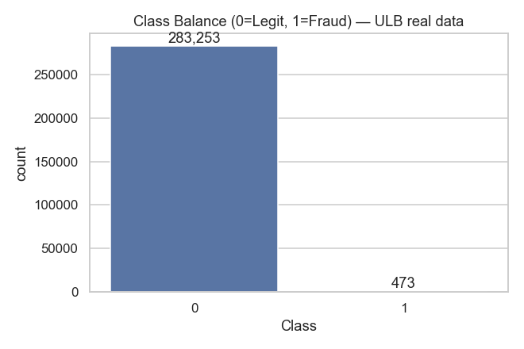
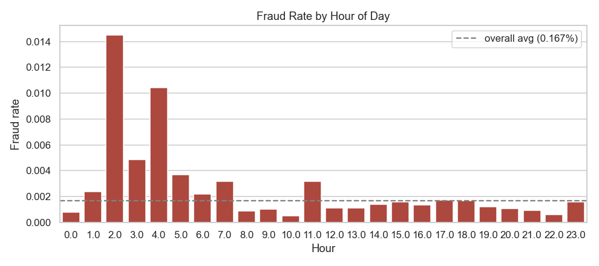
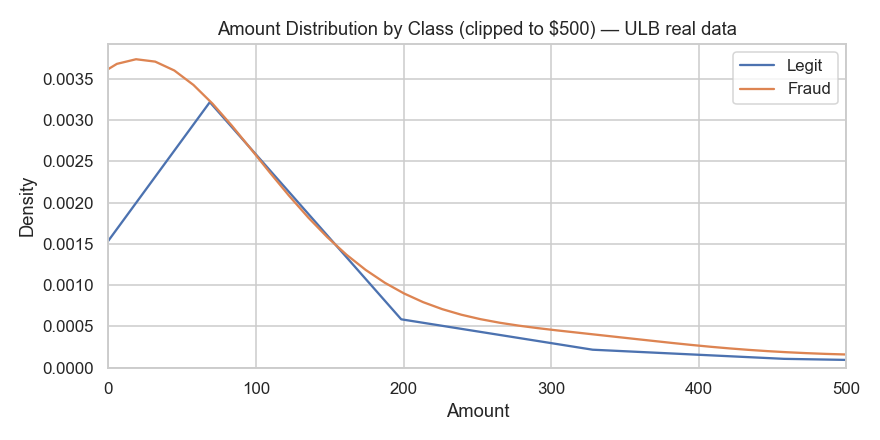
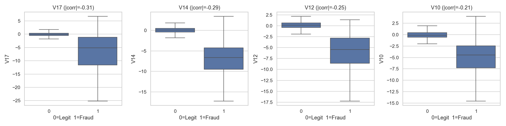
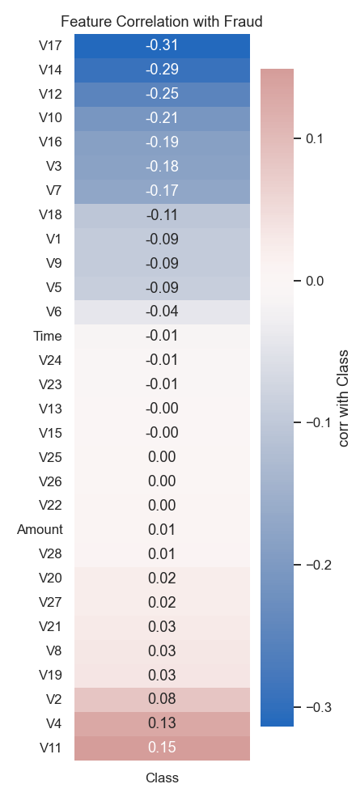
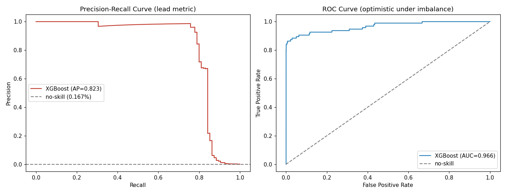
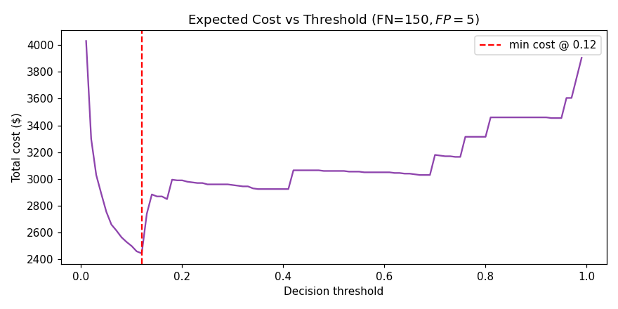
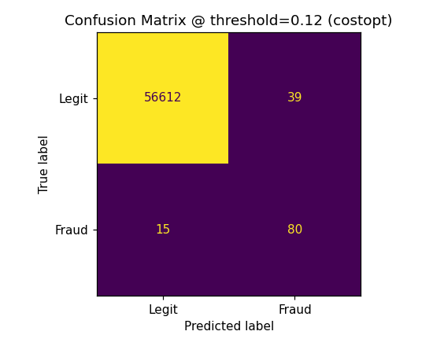

# Financial Fraud Detection — Full Analysis Report

**Author:** Naman · **Date:** 2026-06-09
**Dataset:** ULB Credit Card Fraud (Kaggle, `mlg-ulb/creditcardfraud`)
**Code:** modular pipeline in `src/`, notebooks in `notebooks/`, figures in `reports/figures/`

---

## Executive summary

We built an end-to-end machine-learning pipeline to detect fraudulent credit-card
transactions in a severely imbalanced dataset (**0.17% fraud**). After cleaning,
leak-safe preprocessing, exploratory analysis, and a four-model comparison,
**XGBoost** was the best classifier (**PR-AUC 0.82**). We then tuned the decision
threshold against an explicit cost model and recommend operating at a **0.12
threshold**, which catches **~84% of fraud** and lowers estimated fraud cost
**~20%** versus the naive 0.50 default. Throughout, we measured **recall and
PR-AUC rather than accuracy**, which is meaningless at this level of imbalance.

| Headline metric | Value |
|---|---|
| Transactions analysed (post-dedup) | 283,726 |
| Confirmed fraud | 473 (0.17%) |
| Best model | XGBoost (PR-AUC 0.82, ROC-AUC 0.97) |
| Recommended threshold | 0.12 (cost-optimal) |
| Fraud caught at recommendation | 84% (recall) |
| Estimated cost reduction vs default | ~20% |

---

## 1. Objective

Detect fraudulent transactions and translate the model into an actionable,
cost-aware business decision — not just a classifier, but a recommendation a
fraud-operations team could act on. Success is measured by the ability to catch
fraud (**recall**) while keeping false alarms manageable (**precision**), and by
framing the trade-off in money.

## 2. Data & methodology

**Dataset:** 284,807 European card transactions over two days. Features are
`Time`, `Amount`, an anonymised `Class` label (1 = fraud), and **V1–V28** —
principal components published in place of the raw features for privacy.

**Pipeline (modular, leak-safe by design):**

```
load -> clean (dedup) -> SPLIT (stratified) -> scale (fit on train only)
     -> handle imbalance (train only) -> train 4 models -> evaluate on test
     -> tune threshold by cost
```

The cardinal discipline: **anything that learns from data (scaler statistics,
SMOTE) sees the training set only.** The test set stays an untouched ~0.17%-fraud
sample so every reported number reflects unseen production-like data. This is the
most common place fraud projects accidentally leak and over-report performance.

## 3. Data cleaning

- **Removed 1,081 exact duplicate rows.** Duplicates can land in both train and
  test, leaking information and inflating scores. 283,726 rows remained.
- **No missing values**; confirmed no negative amounts.
- **Outliers were deliberately kept** — in fraud the outlier often *is* the fraud.
- **Scaled `Amount` and `Time` with RobustScaler** (median/IQR based, resistant
  to extreme values). V1–V28 are already PCA-scaled and left as-is.

## 4. Exploratory analysis

### Class imbalance
Fraud is 0.17% of transactions. A model predicting "always legitimate" scores
99.8% accuracy and catches nothing — which is why accuracy is excluded from all
evaluation below.



### Finding 1 — Fraud concentrates at night
Fraud **rate** spikes in the early hours despite that being the lowest-traffic
period: hour 2 ≈ **1.45%** (~8.7× baseline), hour 4 ≈ **1.04%** (~6.2×). A
transaction at 2–4 AM is materially riskier per-dollar.



### Finding 2 — Fraud hides in small amounts
Median fraud amount **$9.25** vs **$22.00** for legitimate transactions —
consistent with *card-testing* (a small validating charge on a stolen card). The
fraud *mean* is higher ($122 vs $88) only because of a few large cases, so median
is the honest summary.



### Finding 3 — A handful of features separate the classes
V17, V14, V12, V10 correlate most strongly with fraud (|corr| 0.21–0.31), all
negative, with little distributional overlap — which is *why* a classifier can
work here. These are PCA components, so we can rank but not interpret them.




## 5. Feature engineering (and an honest negative result)

We engineered three interpretable features — `Hour`, `Amount_log`, and a
`Is_high_amount` flag (>99th percentile, threshold learned on train only). An
audit showed weak linear signal, and when we **re-trained with them included,
they did not improve the model and slightly hurt XGBoost (PR-AUC 0.823 → 0.802).**

We therefore **removed them** and kept the simpler 30-feature model. This is a
deliberate demonstration of disciplined feature selection: *low correlation is
not proof of uselessness (time-of-day and rare-event flags are non-linear), but
features that fail to improve held-out performance should not be retained.*

## 6. Handling class imbalance

With only ~378 fraud cases in training, we compared strategies (applied to
**train only**): balanced **class weights** (minority weight ≈ 300×), XGBoost's
native **`scale_pos_weight` ≈ 600**, and **SMOTE** oversampling. For the final
comparison we used class weights / `scale_pos_weight` rather than synthesising
data, so results reflect genuine signal. (SMOTE is available in `src/imbalance.py`.)

## 7. Model comparison

Four models trained and evaluated on the same untouched test set, ranked by
PR-AUC. SVM was trained on a 30,000-row subsample for tractability (stated openly).

| Model | Recall | Precision | F1 | ROC-AUC | **PR-AUC** | Fit (s) |
|-------|-------:|----------:|---:|--------:|-----------:|--------:|
| **XGBoost** 🏆 | 0.789 | 0.862 | 0.824 | 0.966 | **0.823** | 0.8 |
| Random Forest | 0.716 | 0.971 | 0.824 | 0.945 | 0.808 | 12.1 |
| Logistic Regression *(baseline)* | 0.874 | 0.056 | 0.106 | 0.966 | 0.672 | 0.2 |
| SVM *(subsample)* | 0.484 | 0.414 | 0.447 | 0.937 | 0.474 | 1.7 |

**Key reading — why PR-AUC, not ROC-AUC:** Logistic Regression posts a superb
ROC-AUC (0.966) yet a catastrophic precision of **5.6%** — only ~1 flag in 18 is
real fraud. ROC-AUC is optimistic under heavy imbalance because true negatives
dominate; PR-AUC exposes the truth. XGBoost wins by balancing recall (79%) and
precision (86%).

## 8. Evaluation & threshold tuning

A model outputs a probability; the business value lies in **where we set the
threshold**. The default 0.50 is rarely optimal for fraud.



We swept thresholds against an explicit cost model — **a missed fraud (FN) costs
$150, a false alarm (FP) costs $5** (illustrative; real figures would come from
finance) — and minimised total cost.



| Strategy | Threshold | Caught (TP) | Missed (FN) | False alarms (FP) | Recall | Precision | Est. cost |
|----------|----------:|------------:|------------:|------------------:|-------:|----------:|----------:|
| Default | 0.50 | 75 | 20 | 12 | 79% | 86% | $3,060 |
| Max recall | 0.0006 | 86 | 9 | 3,558 | 91% | 2.4% | $19,140 |
| **Cost-optimal** ✅ | **0.12** | 80 | 15 | 39 | 84% | 67% | **$2,445** |



**Interpretation:** lowering the threshold to 0.12 catches 5 more frauds than the
default for 27 more reviews — worthwhile because a missed fraud costs ~30× a false
alarm, cutting estimated cost ~20%. Chasing maximum recall is *counter-productive*:
it triggers 3,558 false alarms and sextuples cost.

## 9. Business recommendation

1. **Deploy XGBoost at the 0.12 threshold** — best balance of fraud caught vs
   review workload under the stated cost assumptions.
2. **Replace placeholder costs** with finance's real FN/FP figures and re-tune;
   the optimal threshold is a direct function of them.
3. **Pilot in shadow mode** (score live traffic without acting) before any
   automated decline.
4. **Layer with simple rules** (e.g. extra scrutiny on 2–4 AM transactions) for
   defence in depth.
5. **Monitor for drift and retrain** on a schedule — fraud tactics evolve.

## 10. Limitations

- **Offline analysis**, not a production system — no real-time scoring or
  monitoring.
- **Concept drift:** performance decays as fraud patterns change.
- **Anonymised features** preclude business-level explanation and regulatory
  reason-codes.
- **Small fraud sample** (~378 train cases) caps learnable signal; SMOTE cannot
  invent genuinely new fraud types.
- **Cost assumptions are placeholders** that drive the threshold recommendation.
- **One region, two days** — not representative of all fraud or seasonality.

## 11. Reproducibility

```bash
pip install -r requirements.txt          # macOS XGBoost: also `brew install libomp`
# place creditcard.csv in data/raw/
python src/preprocessing.py              # clean + leak-safe splits
python src/models.py                     # train & compare, saves best model
python src/evaluate.py                   # curves + threshold tuning
# or run notebooks/01_eda, 02_eda_deep, 03_modeling end to end
```

Pipeline modules: `data_loader`, `preprocessing`, `eda`, `features`, `imbalance`,
`models`, `evaluate`, `build_dataset` (feature experiment), `make_synthetic`.

## 12. Conclusion & next steps

The project delivers a complete, honest fraud-analytics workflow: from a 0.17%
needle-in-a-haystack problem to a cost-aware deployment recommendation. The
standout analytical results are the **2–4 AM fraud spike (~8×)**, the
**PR-AUC-vs-ROC-AUC lesson** (ROC 0.97 hiding 5.6% precision), and the
**cost-based threshold** that converts a probability into a ~20% cost reduction.

**Next:** apply the same pipeline to the **PaySim** dataset, whose readable
columns (transaction type, account balances) allow genuinely interpretable
feature engineering — and build a Streamlit dashboard exposing the threshold
slider interactively.
